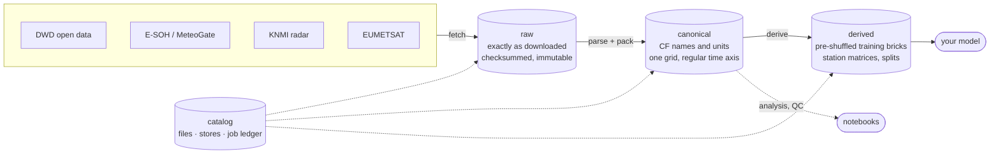
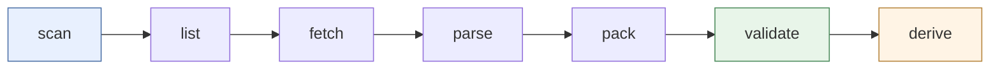
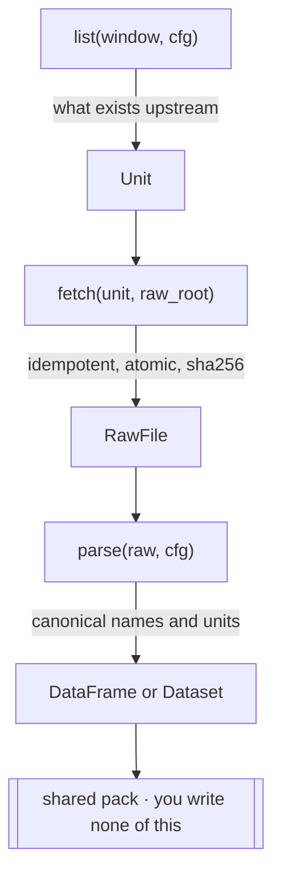

# meteopack

Turns scattered meteorological feeds — radar, satellite, NWP and station
networks across Europe — into **analysis-ready stores** you can train on.

One contract per source, one place that decides what work to do, and stores
that record how they were built.



**Raw is never read by a model.** Each layer has one job, and the catalog knows
what exists so any stage can be re-run, resumed, or skipped.

---

## The pipeline

Every stage is re-runnable. For `fetch`, the ledger makes a second run cheap:
finished units are skipped, and only content that is still changing upstream
(DWD's recent/ and now/, a year or slot not yet closed) is downloaded again -
over the old copy, which survives a failed download. `pack` always rebuilds the
stores it is asked for from the raw files; it is not incremental, and it is
parallel across the cores of one allocation rather than across array tasks.



| Stage | What it does | Writes |
|---|---|---|
| `scan` | reports every schema variant in the raw layer and compares it to the pinned fingerprint | nothing |
| `list` | shows what exists upstream and what is left to do | nothing |
| `fetch` | downloads units in parallel, atomically, rate-limited | `raw/` + catalog |
| `parse` | parses raw files and reports, without writing | nothing |
| `pack` | parses and writes the canonical store | `canonical/` + manifest |
| `validate` | asks whether the store is *usable*, not merely present | nothing |
| `derive` | builds training-shaped bricks, station matrices and splits | `derived/` |

### Why `scan` exists

Upstream schemas drift without warning. `scan` fingerprints what is actually in
the raw layer; the accepted fingerprint is pinned in the product config, and
`parse` refuses to run when the two disagree.

```
$ meteopack scan dwd
scanned 3 files, 1 schema variant(s)
  air_temperature    fp=267791e758f02936 n=3  cols=9
1 of 5 groups scanned and matching (not seen here: extreme_wind, precipitation, solar, wind)
```

Drift exits non-zero, so a Slurm job fails loudly instead of quietly writing a
misaligned store.

---

## Quickstart

```bash
git clone git@github.com:MatsRobben/meteopack.git
cd meteopack
uv sync --extra dev
export METEOPACK_DATA_ROOT=/path/to/your/data      # where everything is written

uv run meteopack list  dwd --limit 3               # what's out there
uv run meteopack fetch dwd --limit 3               # download it
uv run meteopack pack  dwd                         # build the canonical store
uv run meteopack validate dwd                      # is it usable?
uv run meteopack catalog dwd                       # what do I have?
```

A real run of those five commands, end to end, takes a couple of seconds:

```
fetch dwd/stations_10min: 3 to do (1722 listed, 0 already done, 1722 volatile and always refreshed)
fetched 3, absent upstream 0, failed 0
packed 237600 rows into 2 partition file(s)
dwd/stations_10min/v1 [points] OK
  pass  no duplicate (time, station): 0 duplicates
  pass  all times on cadence: 0 rows off the 600s grid
  pass  air_temperature within valid range: [-12.9, 37.8] vs [-60.0, 60.0] degC
```

### Reading it back

```python
from meteopack.core.store import points
from meteopack.core.timeline import Timeline, utc
from datetime import timedelta

df = points.read("dwd/stations_10min/v1", root)              # polars DataFrame
tl = Timeline(utc(2026, 1, 1), utc(2026, 1, 2), timedelta(minutes=10))
values, station_ids = points.to_matrix(                       # dense (time, station)
    "dwd/stations_10min/v1", root, "air_temperature", tl)
```

---

## Where things live

Data lives **outside** the repo, under one configurable root:

```
$METEOPACK_DATA_ROOT/
├── raw/<source>/<product>/YYYY/MM/DD/     exactly as downloaded, immutable
├── canonical/<source>/<product>/vN/       CF names + units, one grid, regular time
│   ├── observations/year=2012/...parquet  (points)  or  store.zarr  (gridded)
│   ├── stations/                          station metadata
│   └── manifest.json                      config hash + code version
├── derived/<dataset>/vN/                  bricks.zarr, splits.parquet, manifest.json
└── catalog/                               files · stores · jobs (the ledger)
```

The repo itself:

```
src/meteopack/
├── core/
│   ├── config.py      every decision as data: retention, cadence, chunks, tiles
│   ├── grids.py       named grids; footprint tests
│   ├── timeline.py    THE regular time axis — nothing hand-rolls one
│   ├── http.py        rate limiting, atomic fetch, tar-on-ingest
│   ├── catalog.py     Parquet catalog + job ledger
│   ├── validate.py    is this store usable?
│   └── store/         gridded.py · points.py · manifest.py
├── sources/           base.py (the contract) · registry.py · dwd.py · esoh.py
├── derive/            bricks · dense_stations · splits
├── jobs/plan.py       what work does THIS task do?
└── cli.py
configs/
├── sources/<source>.yaml            endpoints, rate limits, credentials env names
├── products/<source>/<product>.yaml variables, units, cadence, store layout, fingerprints
├── derive/<dataset>.yaml            inputs, target grid, tile, shards
└── grids.yaml                       named grids
```

---

## Adding a source

A source answers three questions and nothing else. Packing, storage and
scheduling are not its business.



```python
class Source(Protocol):
    name: str
    def list(self, window, cfg) -> list[Unit]: ...
    def fetch(self, unit, raw_root) -> RawFile | None: ...   # None = absent upstream
    def parse(self, raw, cfg) -> pl.DataFrame | xr.Dataset: ...
```

Three steps:

1. `src/meteopack/sources/<name>.py` implementing the protocol (see `dwd.py`).
2. `configs/sources/<name>.yaml` and `configs/products/<name>/<product>.yaml`.
3. Register it in `sources/registry.py` (`BUILTIN`) or via an entry point.

Everything else — rate limiting, retries, atomic writes, the ledger, sharding,
partitioned stores, validation — you get for free.

---

## Running on the cluster

```bash
sbatch slurm/meteopack.slurm pack dwd
sbatch --array=0-29 slurm/meteopack.slurm fetch dwd --window 2012/2013
```

`SLURM_ARRAY_TASK_ID` becomes `--shard/--shards`, so array tasks split the unit
list with no coordination. Units are assigned by stride, not by block, because
file size correlates with station index. This is for `fetch`, `list` and
`derive`; `pack` refuses `--shards`, because concurrent packs of one gridded
store would race on the same shard files. Give one pack job the cores instead
(`--cpus-per-task`; it uses them all by default).

> **cn79 is excluded from every wrapper.** It is a 2012 Sandy Bridge with no
> AVX2, and the `duckdb` and `polars` wheels fault at import there — it looks
> like a mysterious job failure, not a CPU mismatch. See
> [docs/runbooks/cluster.md](docs/runbooks/cluster.md).

---

## Design decisions worth knowing

- **Retention is per layer, per source.** Storage is the binding constraint, so
  each of `raw` / `canonical` / `derived` can be kept, dropped after a stage, or
  staged to cold storage, independently.
- **Full-field and patch-based training are one code path.** `tile` in a derive
  config is the only difference: a full frame is `tile == grid.shape`.
- **Off-cadence observations are dropped, never snapped.** A cadence mismatch
  should surface in validation, not as a silently shifted series.
- **Stations are keyed by WIGOS id**, which is how sources are deduplicated.
- **Volatile units are never skipped.** Archives that are rewritten upstream
  under an unchanged filename would otherwise freeze the live tail.

## Documentation

- [docs/runbooks/credentials.md](docs/runbooks/credentials.md) — which sources need a
  key, where to get it, and what to request next. Nine of the ten are keyless;
  `meteopack credentials` checks this machine.
- [docs/runbooks/cluster.md](docs/runbooks/cluster.md) — Slurm, partitions, cn79
- `docs/history/` — the design documents behind these choices
