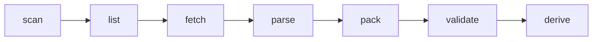

# meteopack

Turns meteorological feeds - KNMI radar, satellite and station networks across
north-west Europe - into **analysis-ready stores**: one regular time axis per
product, consistent names and units, integer-encoded fields that decode to
physical values, and per-frame flags that say what is missing and why.

Every source answers the same three questions (what exists, fetch it, parse
it); storage, scheduling, validation and bookkeeping are shared.

## What you can rely on today

| product | what | status |
|---|---|---|
| `knmi_radar/rtcor_5min` | radar rainfall accumulation, quality, gauge adjustment, 2018- | **packed and verified** against the raw files (2026-11-01) |
| `knmi_radar/echotop_5min` | radar echo top height, 2008- | **packed and verified** |
| `knmi_radar/refl_5min` | radar reflectivity composite, 2008- | **packed and verified** |
| `knmi_insitu/obs_10min` | KNMI automatic weather stations, 2012- | **packed and validated** (2026-11-05): 49.0 M rows, 73 stations |
| `dwd/stations_10min` | German stations inside the radar footprint, 10 min, 2010- | **re-fetched, packed and validated** (2026-11-06): 390 M rows, 539 reporting stations (568 with metadata), closed stations included, to 2026-11-06 |
| `dmi/stations_10min` | Danish stations, 10 min, 2012- | **packed and validated**: 75.0 M rows, 115 stations |
| `belgium/aws_10min` | Belgian AWS, 10 min, 2012- | **packed and validated**: 9.97 M rows, 14 stations |
| `meteofrance/hourly_all` | French stations near NL, hourly, 2010- | **packed**: 12.2 M rows, 237 stations; direct/diffuse/longwave/UV radiation are empty because no in-domain station measures them |
| `midas/hourly_weather` | UK stations, hourly, 2012- | **packed and validated**: 14.0 M rows, 185 stations (positions from the raw file headers when CEDA's token has expired) |
| `ea/rainfall_15min` | England & Wales rain gauges, 15 min, 2012- | **re-fetched, packed and validated** (2026-11-06): 490 M rows, 993 reporting gauges (995 with metadata), every gauge-year 1 Jan - 31 Dec, to 2026-11-06 |
| `eumetsat_seviri/msg15_rss` | MSG SEVIRI rapid scan | works; resampled onto the radar grid, 4 of 11 channels |
| `wow_nl/reports` | WOW-NL citizen weather reports, every report and field as uploaded, **irregular** in time, 2015-2025 | **packed and validated** (2026-11-06): see [docs/stores.md](docs/stores.md#irregular-stores-wow-nl) |
| `training/wow_nl_10min`, `wow_nl_5min` | WOW-NL regularised per station: last/mean/max per bin, rain from the counter | **derived** (2026-11-06); every choice is a parameter (`meteopack derive wow_nl_10min --set ...`) |

On the ICIS/DAS cluster every store above lives under
`/vol/knmimo-nobackup/users/mrobben/meteopack_data/packed/` -
read them directly, there is no need to rebuild them.

## Reading a store

```python
import xarray as xr

ds = xr.open_zarr(".../packed/knmi_radar/rtcor_5min/v1/dataset.zarr", consolidated=False)
usable = ~(ds.is_missing_frame | ds.is_corrupt_frame)     # frames with data
rain = ds.accumulation_mm.sel(time=slice("2024-06-01", "2024-06-02"))
```

Values come out in physical units with NaN where there is no value. "No echo"
is a value, not NaN: 0 mm, 0 km, or -32 dBZ. Each store has a `README.md`
saying exactly what it holds; **[docs/stores.md](docs/stores.md)** explains the
layout, the flags, the provenance table and the station stores.

## Install

Python 3.12 and [uv](https://docs.astral.sh/uv/):

```bash
git clone https://github.com/MatsRobben/meteopack.git
cd meteopack
uv sync --extra radar            # + --extra satellite for SEVIRI, --extra dev for tests
uv run meteopack --help
```

## Building stores yourself

Everything is written under one data root, outside the repo:

```bash
export METEOPACK_DATA_ROOT=/path/to/your/data
```

**Station networks** are downloaded by meteopack. Most need no key (see
[credentials](docs/runbooks/credentials.md)). A small first run, with England's
rain gauges - each file is one gauge's year:

```bash
uv run meteopack list ea                      # what exists upstream (default: the last 24 h)
uv run meteopack fetch ea --limit 5           # download 5 files - drop --limit for all of them
uv run meteopack pack ea                      # build packed/ea/rainfall_15min/v1
uv run meteopack validate ea                  # is it usable?
uv run meteopack catalog ea                   # what is fetched and packed
```

The same commands work for `dwd`, `dmi`, `belgium`, `meteofrance` and `midas`.

**WOW-NL** (citizen weather stations) is read from the local archive of
yearly zips, linked - never copied - into the raw layer:

```bash
mkdir -p $METEOPACK_DATA_ROOT/raw/wow_nl
ln -s /path/to/wow_nl_raw $METEOPACK_DATA_ROOT/raw/wow_nl/reports    # 2015.zip ... 2025.zip
uv run meteopack pack wow_nl                       # the whole archive: 15-17 min on 48 CPUs
uv run meteopack pack wow_nl --window 2024/2024    # rebuild one year; other months untouched
uv run meteopack validate wow_nl
uv run meteopack derive wow_nl_10min               # regular 10-minute grid per station
uv run meteopack derive wow_nl_10min --set step_seconds=300 --set name=wow_nl_5min_try
```
With `--limit` on a network that reports several variables in separate files
(DWD), `validate` will say the variables you did not fetch are missing - it
checks the store against everything the product config promises.

**KNMI radar** is read from a local archive of KNMI's daily tars (from the KNMI
Data Platform). Point meteopack at it and link it into the raw layer - a link,
because `fetch` copies the tars when the archive is on another filesystem:

```bash
export KNMI_RADAR_ARCHIVE=/path/to/nl_rdr_data_rtcor_5m_tar        # one per product:
export KNMI_ECHOTOP_ARCHIVE=/path/to/radar_tar_echotopheight_5min   # *_ECHOTOP_*, *_REFL_*
export KNMI_REFL_ARCHIVE=/path/to/radar_tar_refl_composites
mkdir -p $METEOPACK_DATA_ROOT/raw/knmi_radar
ln -s $KNMI_RADAR_ARCHIVE $METEOPACK_DATA_ROOT/raw/knmi_radar/rtcor_5min

uv run meteopack pack knmi_radar --product rtcor_5min --window 2024-06-01/2024-06-08
uv run meteopack validate knmi_radar --product rtcor_5min
```

Without `--window`, `pack` takes the whole archive and sizes the time axis
from the tar names. A full radar product takes 10-20 minutes on a 48-CPU
cluster job - see [Running on the cluster](#running-on-the-cluster).

If the store already exists, `pack` writes into it: the frames of the files
it is given are rewritten, the rest are kept, and the time axis grows forward
to fit. It cannot grow backwards, so to pack an earlier period into a store
that starts later - or simply to start clean - move the old store aside first.

`--window` is `START/END`: dates are half-open (`2024-06-01/2024-06-08` is
seven days); a bare year or year-month is the whole period, both ends included
(`2012/2013` is two years).

## The data root

```
$METEOPACK_DATA_ROOT/
├── raw/<source>/<product>/        exactly what upstream sent; never modified
├── packed/<source>/<product>/vN/  one analysis-ready store per product - read this
├── training/<dataset>/vN/         datasets built from packed/ for model training
└── _bookkeeping/                  what was downloaded, built, and what failed
```

Each directory has a README of its own. Nothing is edited in place: every
stage writes whole files and moves them into position, so a reader never sees
a half-written one.

## The stages



| stage | what it does | writes |
|---|---|---|
| `scan` | reports every schema variant in `raw/` and compares it with the pinned one | nothing |
| `list` | what exists upstream and what is still to do | nothing |
| `fetch` | downloads, in parallel, atomically, rate-limited, retried, integrity-checked; records why each unit ended | `raw/`, `_bookkeeping/` |
| `parse` | parses raw files and reports what they hold | nothing |
| `pack` | parses and writes the store | `packed/` |
| `validate` | asks whether the store is *usable*, not merely present | nothing |
| `derive` | builds training bricks, station matrices and splits; regularises irregular stores | `training/` |
| `catalog <source>` | what is fetched and packed for a source; `--gaps`: what is missing and why | nothing |
| `credentials` | which keys this machine has, and which are missing | nothing |

`fetch` skips what it already has, and downloads again only what is still
changing upstream (the current year, an open hour, DWD's `recent/`) - over the
old copy, which survives a failed download. `pack` rebuilds a store from all
the raw files it is given; it is not incremental.

**Every unit ends with a reason.** Transient errors (timeouts, resets, 5xx,
429 with its Retry-After) are retried with exponential backoff; a file is
checked before it is published (EA: a whole CSV; DWD: a ZIP whose CRC and
last row are intact). The ledger then records `done`, `empty` (upstream had
nothing), `absent` (404) or `failed` - with the error class, HTTP status,
message and number of attempts. Only `done` is skipped next time, so running
`fetch` again retries the failures. A listing that cannot be read fails the
run instead of planning nothing. To see what is missing from the raw layer:

```bash
uv run meteopack catalog ea --gaps              # per file and per station x year, with the reason
uv run meteopack catalog ea --gaps --out gaps/  # ... and the full tables as CSV
```

**Schema drift fails loudly.** Upstream formats change without notice. Each
product config pins the layouts it has been checked against; a frame in any
other layout is still packed, but `pack` exits non-zero and names it, so a
cluster job fails instead of quietly writing something new.

## Running on the cluster

```bash
# one pack, using every core it is given
sbatch --account=<yours> --exclude=cn79 --cpus-per-task=48 --mem=110G --time=02:00:00 \
  --wrap ".venv/bin/python -m meteopack.cli pack knmi_radar --product echotop_5min"

# a fetch split across an array: pass the task index through yourself
sbatch --account=<yours> --exclude=cn79 --array=0-29 --cpus-per-task=4 --time=04:00:00 \
  --wrap '.venv/bin/python -m meteopack.cli fetch dwd --window 2012/2013 \
          --shard $SLURM_ARRAY_TASK_ID --shards $SLURM_ARRAY_TASK_COUNT'
```

`--shard/--shards` split `fetch`, `list` and `derive` across array tasks with
no coordination; the source's configured request rate is shared between the
tasks, so an array is no harder on upstream than one job. `pack` refuses them - two packs of one store would race on
the same files - so give one pack job the cores instead; it uses all of them.

Worth knowing (details in [docs/runbooks/cluster.md](docs/runbooks/cluster.md)):

* **Always `--exclude=cn79`** - no AVX2, and polars/duckdb crash at import there.
* A Slurm CPU is a hyperthread: 48 CPUs is 24 physical cores.
* The shared NFS server delivers ~230 MiB/s in total across all nodes, ~165 per
  node. rtcor is read-bound from ~24 workers; echotop and refl want the cores.
* Each radar worker needs ~1 GB (rtcor's 2023 tars: ~2.2 GB).

## Configuration

Every decision is data, not code:

```
configs/
├── sources/<source>.yaml            endpoints, rate limits, credential locations
├── products/<source>/<product>.yaml variables, units, encoding, cadence, pinned layouts
├── derive/<dataset>.yaml            inputs, target grid, tile, shards
└── grids.yaml                       named grids
```

A product's variables say where each value comes from (`source_key`), its
units and valid range, how it is stored (`encoding`), and for radar what "no
echo" is (`no_echo`). Renaming a variable or changing its encoding is a config
edit and a re-pack.

## Adding a source

A source answers three questions and nothing else:

```python
class Source(Protocol):
    name: str
    def list(self, window, cfg) -> list[Unit]: ...            # what exists upstream
    def fetch(self, unit, raw_root) -> RawFile | None: ...    # None = absent upstream
    def parse(self, raw, cfg) -> pl.DataFrame | xr.Dataset: ...  # canonical names and units
```

1. `src/meteopack/sources/<name>.py` implementing it (`dwd.py` is a good model).
2. `configs/sources/<name>.yaml` and `configs/products/<name>/<product>.yaml`.
3. Register it in `sources/registry.py`.

Rate limiting, retries, atomic writes, the ledger, partitioned and gridded
stores, validation and the README in each store come with it.

## Development

```bash
uv sync --extra dev --extra radar --extra satellite
uv run pytest -q          # ~840 tests, about a minute
uv run ruff check src tests
```

Tests that read real archives skip when the archive is not on the machine.

## Documentation

* [docs/stores.md](docs/stores.md) - what is in a store and how to read it
* [docs/runbooks/credentials.md](docs/runbooks/credentials.md) - which sources need a key, where to get it, where it goes
* [docs/runbooks/cluster.md](docs/runbooks/cluster.md) - Slurm accounts, limits, node facts
* [docs/architecture/output_revision.md](docs/architecture/output_revision.md) - why the stores look the way they do (design record)
